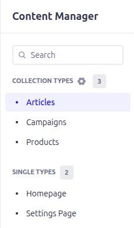
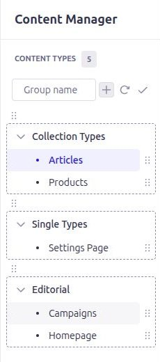
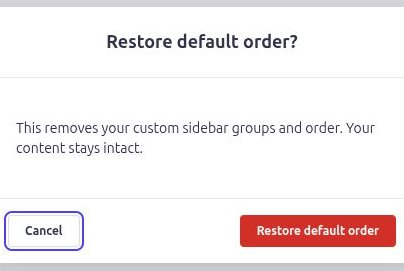

# Content Manager Sidebar for Strapi

Customize the contents of the native Strapi sidebar to fit your workflow. Create your own groups, mix collection types and single types, and arrange them in the order you want. The same sidebar stays visible when you open a list or edit an entry.

## Installation

The adapter targets Strapi 5.60.x through 5.62.x with Vite. See Verification for the exact versions tested. The sidebar is an internal Strapi component, so each new version requires validation.

Once the first release is available on npm, run this command from your Strapi application directory.

```sh
npm install @3xweb/strapi-plugin-content-manager-sidebar
```

Wrap your existing Vite configuration as shown below.

```ts
// src/admin/vite.config.ts
import { withContentManagerSidebar } from '@3xweb/strapi-plugin-content-manager-sidebar';
import type { UserConfig } from 'vite';

export default (config: UserConfig) => withContentManagerSidebar(config);
```

Rebuild or restart the Strapi admin. This extension runs in the admin build and requires no server plugin configuration.

## Usage

### Open the organizer

In **Content Manager**, select the gear next to the content types heading. The organizer shows controls to add a group, reset the sidebar, and finish organizing.



### Customize the sidebar

1. Enter a group name and select **+**. Use any grouping that fits your workflow, such as **Editorial**, **Catalog**, or **Settings**.
2. Drag a content type by its row and drop it inside the dashed outline of the destination group. In the example below, **Editorial** contains the **Campaigns** collection and the **Homepage** single type.
3. To reorder items, drag one over the upper or lower half of another row. The blue line shows where it will land. With a keyboard, select the item's handle and use **Before** or **Inside**.
4. Select the checkmark beside the reset icon to finish organizing.



### Restore the default order

Select the circular arrow and confirm **Restore default order**. The reset clears your custom sidebar groups and order. Your content stays intact. Select **Cancel** to keep your arrangement.



The arrangement is stored in the current browser profile and scoped to the Strapi instance. It survives navigation and reloads. Group names and content-type identifiers are kept in browser storage. Admin accounts using the same browser profile and Strapi instance share this arrangement. Use separate browser profiles for independent arrangements. New visible types appear at the end of a custom layout, and native access permissions continue to determine which content links are visible.

## Uninstall

Remove the wrapper import and call from your Vite configuration. Then uninstall the package and rebuild the Strapi admin.

```sh
npm uninstall @3xweb/strapi-plugin-content-manager-sidebar
```

## Verification

- The package entry point and organizer module loaded after a local installation test in an isolated project.
- The compact organizer was checked in Strapi 5.60.0. Dragging the Campaigns row onto a closed Editorial group moved it into the group. Dragging the Homepage row onto the group produced a mixed group, which survived a reload.

- Browser testing used Strapi 5.60.0, Node 22.22.3, and SQLite. The admin was built with `strapi build` (Vite) and served with `strapi start`. With sample data, the **Inside** control grouped Articles and Homepage together and put Products in a separate group. Dragging Homepage before Articles reordered the mixed group. The **Before** control also reordered its items. The saved order persisted through navigation from the article list to an entry and back, and after reloading.
- A Reader role with read access only to Articles saw only the Articles link. The group containing Products stayed visible in organize mode and offered no **Remove group** control. Before the confirmation dialog was added, resetting as Reader restored the native sections after a reload. The current dialog was verified by keyboard on Strapi 5.60.0. Cancel kept the custom layout, and confirmation restored the default layout.
- The native sidebar source transformation and JavaScript syntax checks passed on Strapi 5.60.0 and 5.62.0 in the November 2026 validation. The adapter had also previously passed the source check on 5.61.1.
- `npm test` covers mixed groups, reordering, permission-filtered links, and protection against removing a group that still holds entries hidden by native permissions. Set `STRAPI_FIXTURES` to a colon-separated list of installed Strapi application directories to include the source transformation checks.
